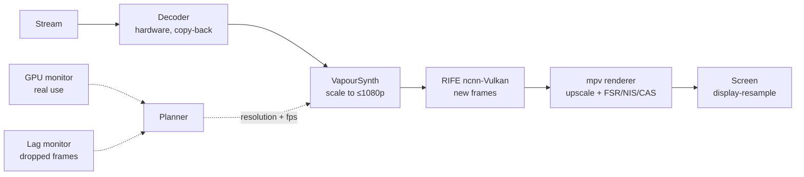

<div align="center">
<a name="top"></a>


# Harbor Frame Generation

**AI frame generation and GPU upscaling built into Harbor's player, for Windows.**

[English](#english) · [العربية](#arabic) · [Download](https://github.com/abogzah559-wq/harbor-frame-generation/releases/latest)

</div>

---

<a name="english"></a>

## What it is

Harbor Frame Generation is a build of [Harbor](docs/HARBOR-UPSTREAM.md) (a desktop client for the Stremio addon protocol) that adds **Boost** to its native mpv player:

| Feature | What you get |
|---|---|
| **AI frame generation (RIFE)** | New in-between frames made by a neural network. A 24 fps film plays at 48, 60 or more fps. Runs inside Harbor's own player, no external program. |
| **Smooth mode** | Light frame blending to your screen's refresh rate. Works on any GPU. |
| **Upscaling** | FSR, NIS or CAS shaders with adjustable sharpness. |
| **GPU limit you can trust** | You set a limit (default 80 %). Boost reads the real GPU use, the same number Task Manager shows, and keeps the GPU working right up to that limit: no lag, and no unused power. |

## Install

1. Download `Harbor_…_x64-setup.exe` from the [latest release](https://github.com/abogzah559-wq/harbor-frame-generation/releases/latest).
2. The installer isn't code-signed, so Windows SmartScreen may warn: click **More info → Run anyway**.
3. Play a film or an episode and click **✦** on the player bar. The gear next to it opens the settings.

The first time you switch frame generation on, about 60 MB of runtime (Python, VapourSynth, the RIFE engine and one model) is downloaded once.

## Recommended settings

| Setting | Recommended | Why |
|---|---|---|
| Model | **RIFE 4.6** | Fastest, good quality. Heavier models work too; Boost lowers the frame rate or resolution to stay inside your limit. |
| Output | **Auto** | Picks the smoothest frame rate that fits your GPU and divides your refresh rate evenly (240 Hz → 48 / 60 / 80 fps). |
| Processing resolution | **Auto** | Up to 1080p. 4K and 1440p videos are interpolated at 1080p and scaled back up, because RIFE is 3× slower at 1440p and 11× slower at 4K. |
| GPU limit | **80 %** | Room for the decoder, the renderer and anything else running. Raise it if the PC does nothing else while you watch. |

The settings panel shows what Boost is doing right now, for example `2160p → 1080p · 60 fps · GPU 78% / 80%`: source and processing resolution, output frame rate, and **real** GPU use against your limit.

## How it works



1. **Calibration.** Once per GPU and model, Boost measures how many frames per second RIFE makes at 720p and 1080p (a 3-4 second pause the first time).
2. **Planning.** For every video it picks the processing resolution and an output frame rate that is a whole divisor of your refresh rate, so every frame stays on screen for the same time (no judder).
3. **Paced work.** mpv asks VapourSynth for a few frames at a time with a deep buffer, so the GPU works at an even pace instead of 100 % bursts that starve the renderer.
4. **Real GPU feedback.** While you watch, Boost reads the GPU's real use every few seconds (nvidia-smi on NVIDIA cards, Windows GPU engine counters on others). Well under your limit → it raises the frame rate or resolution. Over the limit → it lowers them.
5. **Lag guard.** If frames still drop, the load is lowered and that plan is blocked for 10 minutes so Boost doesn't climb straight back to it.

## Troubleshooting

| Problem | Fix |
|---|---|
| Picture hitches or the quality drops while the film is buffering | Fixed in boost-4: frames lost to a slow network are no longer treated as a slow GPU. |
| Quality stays low on a strong GPU | Open the settings and press **Measure now**. Boost-4 also raises the plan by itself when the GPU has room. |
| `lua51.dll was not found` | Fixed in boost-3. On an older build, unzip `mpv-fix-x64.zip` from the release into `%LOCALAPPDATA%\Harbor`. |
| Frame generation runs on the wrong GPU | Pick your graphics card under **GPU** in the advanced settings. |

## Build from source

Needs Node 22, pnpm, the Rust stable toolchain (MSVC) and the Tauri prerequisites.

```bash
pnpm install
pnpm run setup:libmpv
pnpm tauri build
```

Windows installers are built by the `windows-build` workflow. Pushing a tag such as `boost-4` publishes a release with the notes in [docs/RELEASE-NOTES.md](docs/RELEASE-NOTES.md).

| Part | Where |
|---|---|
| Planner, GPU feedback, lag guard | `src/lib/boost.ts` |
| Settings panel | `src/components/player/boost/` |
| Runtime install, VapourSynth script, calibration, GPU reading | `src-tauri/src/boost.rs` |

## Credits and license

Built on [Harbor](docs/HARBOR-UPSTREAM.md) (MIT). Frame generation uses [RIFE](https://github.com/hzwer/Practical-RIFE) through [VapourSynth-RIFE-ncnn-Vulkan](https://github.com/styler00dollar/VapourSynth-RIFE-ncnn-Vulkan) and [VapourSynth](https://www.vapoursynth.com/). Upscaling shaders by [agyild](https://gist.github.com/agyild). Released under the [MIT License](LICENSE).

Harbor is a player. It hosts, indexes and ships no media and bundles no content addons. Follow the laws where you live.

<p align="right"><a href="#top">↑ Top</a></p>

---

<a name="arabic"></a>

<div dir="rtl">

## وش هو البرنامج

**Harbor Frame Generation** نسخة من [Harbor](docs/HARBOR-UPSTREAM.md) (برنامج لمشاهدة الأفلام والمسلسلات عن طريق إضافات Stremio) تضيف ميزة **Boost** للمشغّل:

| الميزة | وش تسوي |
|---|---|
| **توليد فريمات بالذكاء الاصطناعي (RIFE)** | تصنع فريمات جديدة بين الفريمات الأصلية. الفيلم اللي على 24 فريم يصير 48 أو 60 أو أكثر. تشتغل داخل مشغّل Harbor نفسه بدون أي برنامج ثاني. |
| **الوضع السلس** | دمج خفيف للفريمات على تردّد شاشتك. يشتغل على أي كرت. |
| **التكبير** | FSR أو NIS أو CAS مع التحكم بالحدّة. |
| **حد استهلاك حقيقي للكرت** | تختار الحد (الافتراضي 80%). Boost يقرأ استهلاك الكرت الحقيقي، نفس الرقم اللي يطلع في إدارة المهام، ويخلي الكرت يشتغل لين هذا الحد بالضبط: بدون تقطيع، وبدون قوة ضايعة. |

## التثبيت

1. حمّل ملف `Harbor_…_x64-setup.exe` من [آخر إصدار](https://github.com/abogzah559-wq/harbor-frame-generation/releases/latest).
2. الملف غير موقّع، فممكن يطلع لك تحذير ويندوز الأزرق: اضغط **More info** وبعدها **Run anyway**.
3. شغّل أي فيلم أو حلقة واضغط زر **✦** في شريط المشغّل. الترس اللي جنبه يفتح الإعدادات.

أول مرة تشغّل توليد الفريمات يتحمّل تقريبًا 60 ميجا مرة وحدة بس.

## الإعدادات اللي ننصح فيها

| الإعداد | ننصح بـ | ليش |
|---|---|---|
| النموذج | **RIFE 4.6** | الأسرع وجودته ممتازة. النماذج الأثقل تشتغل بعد، بس Boost بينزّل الفريمات أو الدقة عشان يبقى تحت حدك. |
| الناتج | **تلقائي** | يختار أنعم عدد فريمات يناسب كرتك وينقسم على تردّد شاشتك بالتساوي (240 هرتز ← 48 أو 60 أو 80). |
| دقة المعالجة | **تلقائي** | حتى 1080p. أفلام 4K و2K تتعالج على 1080p وبعدين تتكبّر وترجع، لأن RIFE أبطأ 3 مرات على 2K و11 مرة على 4K. |
| حد استهلاك الكرت | **80%** | يترك مساحة لفك الفيديو والعرض وأي برنامج ثاني. ارفعه لو الجهاز ما يسوي شي ثاني وقت المشاهدة. |

لوحة الإعدادات توريك وش يسوي Boost الحين، مثلًا `2160p → 1080p · 60 fps · GPU 78% / 80%`: دقة الفيديو ودقة المعالجة، وعدد الفريمات، واستهلاك الكرت **الحقيقي** مقابل حدك.

## كيف يشتغل

1. **القياس:** مرة وحدة لكل كرت ونموذج، Boost يقيس كم فريم يطلّع RIFE في الثانية على 720p و1080p (وقفة 3-4 ثواني أول مرة بس).
2. **التخطيط:** لكل فيديو يختار دقة المعالجة وعدد فريمات ينقسم على تردّد شاشتك بالتساوي، عشان كل فريم يبقى على الشاشة نفس المدة (بدون رجفة).
3. **شغل منتظم:** المشغّل يطلب الفريمات على دفعات صغيرة مع مخزن كبير، فالكرت يشتغل بوتيرة ثابتة بدل قفزات 100% تخنق العرض.
4. **قراءة الكرت الحقيقية:** وقت المشاهدة يقرأ Boost استهلاك الكرت كل كم ثانية (nvidia-smi لكروت NVIDIA، وعدّادات ويندوز للباقي). لو الكرت تحت الحد بكثير يرفع الفريمات أو الدقة، ولو تعدّى الحد ينزّلها.
5. **حماية من التقطيع:** لو ضاعت فريمات ينزّل الحمل، ويمنع الرجوع لنفس الإعداد 10 دقايق عشان ما يتذبذب.

## حل المشاكل

| المشكلة | الحل |
|---|---|
| تقطيع أو نزول جودة وقت تحميل الفيلم | انحلّت في boost-4: الفريمات اللي تضيع بسبب بطء النت ما صارت تنحسب على الكرت. |
| الجودة نازلة مع إن كرتك قوي | افتح الإعدادات واضغط **قِس الحين**. وboost-4 يرفع الجودة لحاله إذا الكرت فيه مجال. |
| رسالة `lua51.dll was not found` | انحلّت في boost-3. لو عندك نسخة أقدم، فك `mpv-fix-x64.zip` من الإصدار داخل `%LOCALAPPDATA%\Harbor`. |
| توليد الفريمات يشتغل على الكرت الغلط | اختر كرتك من **GPU** في الإعدادات المتقدمة. |

## الحقوق والترخيص

مبني على [Harbor](docs/HARBOR-UPSTREAM.md) (رخصة MIT). توليد الفريمات يستخدم RIFE عن طريق VapourSynth-RIFE-ncnn-Vulkan وVapourSynth. ملفات التكبير من agyild. المشروع تحت [رخصة MIT](LICENSE).

Harbor مجرد مشغّل: ما يستضيف ولا يوفّر أي محتوى ولا يجي معه أي إضافات محتوى. التزم بقوانين بلدك.

</div>

<p align="right"><a href="#top">↑ للأعلى</a></p>
