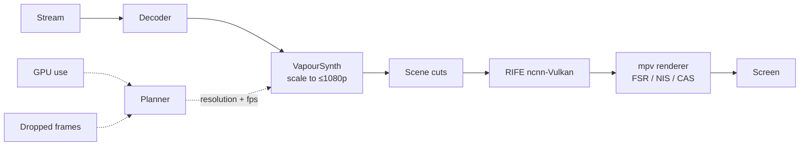

<div align="center">
<a name="top"></a>


# Harbor Frame Generation

**Smooth playback for films, series and anime: RIFE frame generation and GPU upscaling inside Harbor's player, for Windows.**

[Download the latest release](https://github.com/abogzah559-wq/harbor-frame-generation/releases/latest) · [Release notes](docs/RELEASE-NOTES.md)

</div>

---

## Overview

This is a Windows build of [Harbor](docs/HARBOR-UPSTREAM.md), a desktop client for Stremio addons, with **Boost** added to its mpv player. Boost turns a 24 fps film into 48, 60 or more frames per second while it plays, sharpens the picture, and keeps your graphics card inside a limit you choose. Everything runs inside Harbor: no second program, no capture, no overlay.

| | |
|---|---|
| **Frame generation** | RIFE creates the frames in between the real ones, on your GPU (Vulkan, any vendor). |
| **Smooth mode** | Light frame blending to your refresh rate, for weaker GPUs. |
| **Upscaling** | FSR, NIS or CAS with adjustable sharpness. |
| **GPU limit** | You set a limit (80 % by default). Boost reads the real GPU use, the number Task Manager shows, and works up to it. |
| **Head start** | Frames are made up to 2 s ahead of the picture, so a heavy scene is covered by frames already finished. |
| **Scene cuts** | Real cuts switch cleanly instead of morphing. Fast camera moves are still interpolated. |
| **Updates** | Harbor checks for a new release every 30 minutes, downloads it in the background and installs it when you close Harbor, or right away with **Restart now** in Settings → Advanced. |

## Install

1. Download `Harbor_…_x64-setup.exe` from the [latest release](https://github.com/abogzah559-wq/harbor-frame-generation/releases/latest).
2. The installer is not code-signed. If SmartScreen warns, choose **More info → Run anyway**.
3. Play something and press **✦** on the player bar. The gear next to it opens the Boost settings.

The first time frame generation is switched on, about 60 MB (Python, VapourSynth, the RIFE engine and one model) is downloaded once.

## Recommended settings

| Setting | Value | Notes |
|---|---|---|
| Model | **RIFE 4.6** | Fastest with good quality. Heavier models work; Boost lowers resolution or frame rate to stay in your limit. |
| Output | **Auto** | The smoothest rate that fits your GPU and divides your refresh rate evenly (240 Hz → 48 / 60 / 80 fps). |
| Processing resolution | **Auto** | Up to 1080p. RIFE is about 3× slower at 1440p and 11× slower at 4K, so larger video is interpolated at 1080p and scaled back up. |
| GPU limit | **80 %** | Leaves room for decoding and rendering. |
| Head start | **1 s** | 2 s covers longer spikes but uses more memory and refills more slowly after a seek. |
| Scene detection | **On** | |

The settings panel shows what Boost is doing at that moment, for example `2160p → 1080p · 60 fps · GPU 78% / 80%`.

## How it works



1. **Calibration.** Once per GPU and model, Boost measures RIFE's speed at 720p and 1080p (a short pause the first time).
2. **Planning.** For each video it picks a processing resolution and an output rate that divides the refresh rate, so every frame stays on screen for the same time.
3. **Scene cuts.** A tiny copy of each frame is compared with the next. A cut is a change that stands out sharply from the frames around it, or a jump in the brightness histogram. A fast pan changes a lot too, but steadily and without moving the histogram, so it is still interpolated.
4. **Paced work.** mpv asks for frames ahead of the one on screen with a deep buffer, so the GPU works at an even pace instead of in bursts.
5. **GPU feedback.** Every few seconds Boost reads the real GPU use (nvidia-smi on NVIDIA, Windows GPU counters on others). Well under the limit, it raises the plan; over it, it lowers the plan and keeps that plan off for 10 minutes so it doesn't swing back and forth.
6. **Lag guard.** If frames keep dropping well after a change (not right after a seek or a reload), the plan is lowered.

## Troubleshooting

| Problem | What to do |
|---|---|
| Quality stays low on a strong GPU | Boost settings → **Measure now**. |
| Frame generation runs on the wrong GPU | Pick your card under **Graphics card** in the Boost settings. |
| `lua51.dll was not found` (old builds) | Unzip `mpv-fix-x64.zip` from the release into `%LOCALAPPDATA%\Harbor`. |
| Something looks wrong | Settings → Report a bug → **Export player log**, then attach the file to an issue. |

## Build from source

Requires Node 22, pnpm, Rust stable (MSVC) and the [Tauri prerequisites](https://tauri.app/start/prerequisites/).

```bash
pnpm install
pnpm run setup:libmpv
pnpm run setup:fonts
pnpm tauri build
```

Release installers are built by the `windows-build` workflow. Running it with a `release_tag` such as `boost-8` publishes a release with [docs/RELEASE-NOTES.md](docs/RELEASE-NOTES.md) as its notes. The `scene-cut-test` workflow runs the scene-cut detector in the same VapourSynth runtime Boost installs, on real video.

| Part | Where |
|---|---|
| Planner, GPU feedback, lag guard | `src/lib/boost.ts` |
| Boost settings panel | `src/components/player/boost/` |
| Runtime install, VapourSynth script, calibration, GPU reading | `src-tauri/src/boost.rs` |
| Self-update | `src/lib/selfupdate.ts` |
| Rust core shared with Harbor | `harbor-core/` |

## Credits and license

Built on [Harbor](docs/HARBOR-UPSTREAM.md) (MIT). All credit for Harbor itself goes to its original team, who are no longer working on it. This edition is made and maintained by **3zT**. Frame generation uses [RIFE](https://github.com/hzwer/Practical-RIFE) through [VapourSynth-RIFE-ncnn-Vulkan](https://github.com/styler00dollar/VapourSynth-RIFE-ncnn-Vulkan) and [VapourSynth](https://www.vapoursynth.com/). Upscaling shaders by [agyild](https://gist.github.com/agyild). Released under the [MIT License](LICENSE).

Harbor is a player. It hosts, indexes and ships no media and bundles no content addons. Follow the laws where you live.

<p align="right"><a href="#top">↑ Top</a></p>
