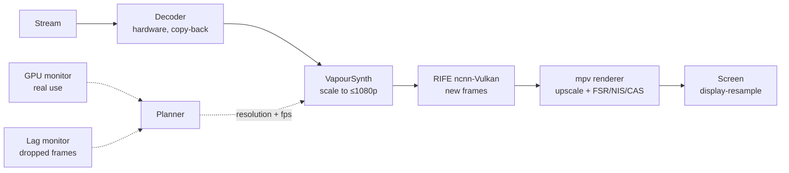

<div align="center">
<a name="top"></a>


# Harbor Frame Generation

**AI frame generation and GPU upscaling built into Harbor's player, for Windows.**

[Download](https://github.com/abogzah559-wq/harbor-frame-generation/releases/latest)

</div>

---

## What it is

Harbor Frame Generation is a build of [Harbor](docs/HARBOR-UPSTREAM.md) (a desktop client for the Stremio addon protocol) that adds **Boost** to its native mpv player:

| Feature | What you get |
|---|---|
| **AI frame generation (RIFE)** | New in-between frames made by a neural network. A 24 fps film plays at 48, 60 or more fps. Runs inside Harbor's own player, no external program. |
| **Smooth mode** | Light frame blending to your screen's refresh rate. Works on any GPU. |
| **Upscaling** | FSR, NIS or CAS shaders with adjustable sharpness. |
| **GPU limit you can trust** | You set a limit (default 80 %). Boost reads the real GPU use, the same number Task Manager shows, and keeps the GPU working right up to that limit: no lag, and no unused power. |
| **Head start** *(new)* | RIFE works up to 2 seconds ahead of the picture on screen, the way a video buffers before you reach it. Heavy scenes and short GPU spikes are absorbed by the frames already made, so they never show as a stutter. |
| **Clearer home banner** *(new)* | The featured film or series at the top of the home page is taller and brighter, with lighter shading over the picture, and a bar under it fills up until the next title comes. |

## What Harbor does

- Browse films, series and anime from your Stremio addons, with catalogs, search, a watch list, continue-watching and calendars.
- Play streams in a native mpv player with subtitles, audio tracks, casting and downloads.
- Boost (below) adds frame generation, upscaling and a GPU budget to that player.

## Install

1. Download `Harbor_…_x64-setup.exe` from the [latest release](https://github.com/abogzah559-wq/harbor-frame-generation/releases/latest).
2. The installer isn't code-signed, so Windows SmartScreen may warn: click **More info → Run anyway**.
3. Play a film or an episode and click **✦** on the player bar. The gear next to it opens the settings.

The first time you switch frame generation on, about 60 MB of runtime (Python, VapourSynth, the RIFE engine and one model) is downloaded once.

## Recommended settings

| Setting | Recommended | Why |
|---|---|---|
| Model | **RIFE 4.6** | Fastest, good quality. Heavier models work too; Boost lowers the frame rate or resolution to stay inside your limit. |
| Output | **Auto** | Picks the smoothest frame rate that fits your GPU and divides your refresh rate evenly (240 Hz → 48 / 60 / 80 fps). |
| Processing resolution | **Auto** | Up to 1080p. 4K and 1440p videos are interpolated at 1080p and scaled back up, because RIFE is 3× slower at 1440p and 11× slower at 4K. |
| GPU limit | **80 %** | Room for the decoder, the renderer and anything else running. Raise it if the PC does nothing else while you watch. |
| Head start | **1 s** | Enough to smooth out heavy scenes. 2 s absorbs longer spikes but uses more memory and takes a moment longer to fill after a seek. Off keeps only the few frames mpv needs next. |

The settings panel shows what Boost is doing right now, for example `2160p → 1080p · 60 fps · GPU 78% / 80%`: source and processing resolution, output frame rate, and **real** GPU use against your limit.

## How it works



1. **Calibration.** Once per GPU and model, Boost measures how many frames per second RIFE makes at 720p and 1080p (a 3-4 second pause the first time).
2. **Planning.** For every video it picks the processing resolution and an output frame rate that is a whole divisor of your refresh rate, so every frame stays on screen for the same time (no judder).
3. **Paced work and head start.** mpv asks VapourSynth for frames ahead of the one on screen, with a deep buffer, so the GPU works at an even pace instead of 100 % bursts that starve the renderer. With **Head start** on, mpv keeps decoding and RIFE keeps making frames up to 1 or 2 seconds ahead (at most 96 finished frames waiting, mpv's limit is 99; the decoded-frame buffer is sized to just what that window needs, so memory stays low), so a slow moment is covered by frames that are already finished.
4. **Real GPU feedback.** While you watch, Boost reads the GPU's real use every few seconds (nvidia-smi on NVIDIA cards, Windows GPU engine counters on others). Well under your limit → it raises the frame rate or resolution. Over the limit → it lowers them.
5. **Lag guard.** If frames still drop, the load is lowered and that plan is blocked for 10 minutes so Boost doesn't climb straight back to it.

## Troubleshooting

| Problem | Fix |
|---|---|
| Picture hitches or the quality drops while the film is buffering | Fixed in boost-4: frames lost to a slow network are no longer treated as a slow GPU. |
| Quality stays low on a strong GPU | Open the settings and press **Measure now**. Boost-4 also raises the plan by itself when the GPU has room. |
| `lua51.dll was not found` | Fixed in boost-3. On an older build, unzip `mpv-fix-x64.zip` from the release into `%LOCALAPPDATA%\Harbor`. |
| Frame generation runs on the wrong GPU | Pick your graphics card under **GPU** in the advanced settings. |

## Build from source

Needs Node 22, pnpm, the Rust stable toolchain (MSVC) and the Tauri prerequisites.

```bash
pnpm install
pnpm run setup:libmpv
pnpm tauri build
```

Windows installers are built by the `windows-build` workflow. Pushing a tag such as `boost-4` publishes a release with the notes in [docs/RELEASE-NOTES.md](docs/RELEASE-NOTES.md).

| Part | Where |
|---|---|
| Planner, GPU feedback, lag guard | `src/lib/boost.ts` |
| Settings panel | `src/components/player/boost/` |
| Home banner | `src/components/hero.tsx`, `src/components/hero-carousel.tsx` |
| Runtime install, VapourSynth script, calibration, GPU reading | `src-tauri/src/boost.rs` |

## Credits and license

Built on [Harbor](docs/HARBOR-UPSTREAM.md) (MIT). Frame generation uses [RIFE](https://github.com/hzwer/Practical-RIFE) through [VapourSynth-RIFE-ncnn-Vulkan](https://github.com/styler00dollar/VapourSynth-RIFE-ncnn-Vulkan) and [VapourSynth](https://www.vapoursynth.com/). Upscaling shaders by [agyild](https://gist.github.com/agyild). Released under the [MIT License](LICENSE).

Harbor is a player. It hosts, indexes and ships no media and bundles no content addons. Follow the laws where you live.

<p align="right"><a href="#top">↑ Top</a></p>
